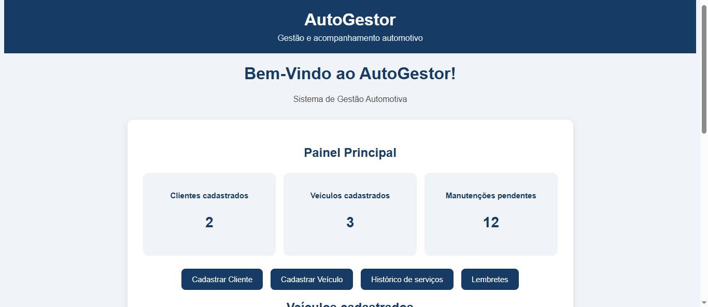
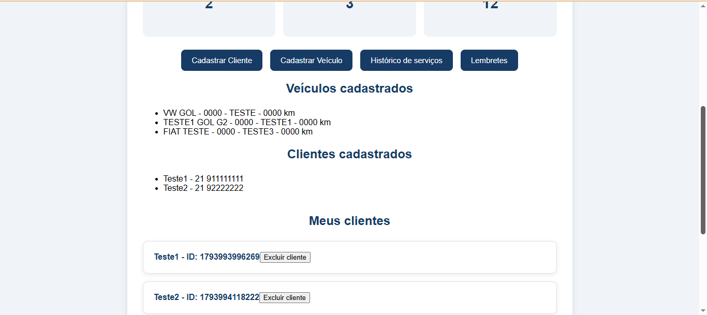
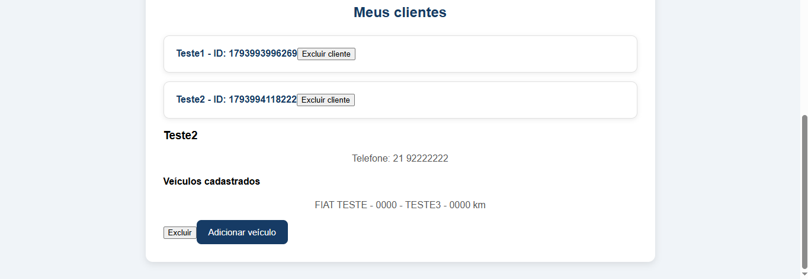
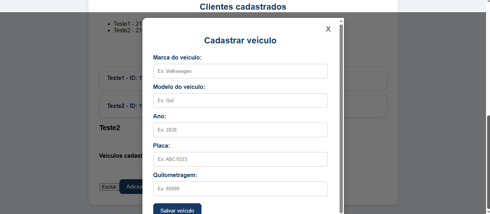
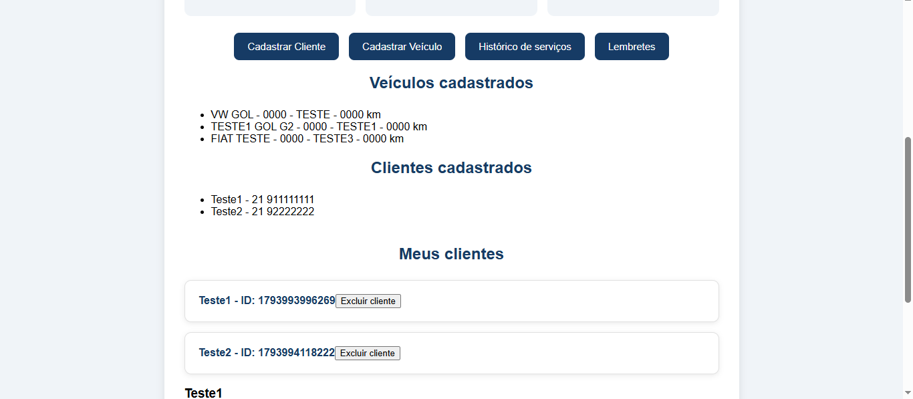
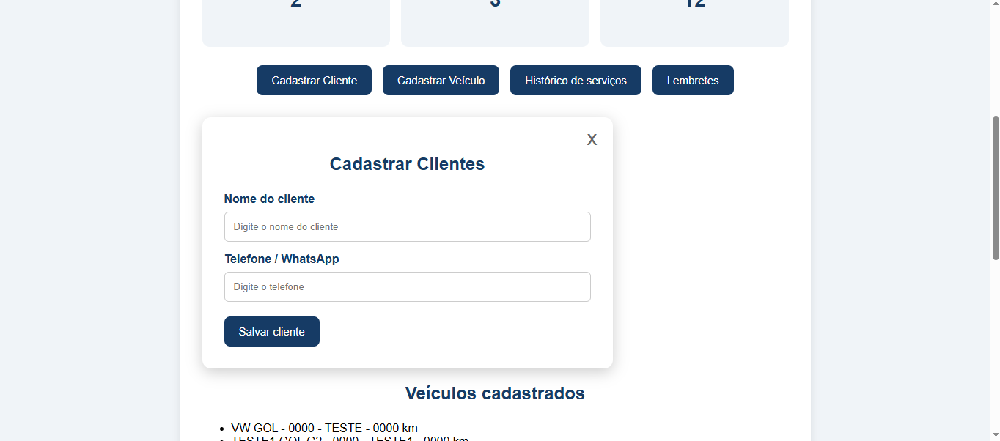

🚗 AutoGestor

Gestão inteligente de clientes, veículos e manutenções automotivas.

Projeto independente em desenvolvimento.

📌 Sobre o projeto

O AutoGestor é um projeto de desenvolvimento de software voltado ao setor automotivo, criado com o objetivo de facilitar a gestão de clientes, veículos e históricos de manutenções.

A proposta é centralizar informações que muitas vezes ficam dispersas, oferecendo uma maneira organizada de acompanhar os veículos de cada cliente e os serviços realizados ao longo do tempo.

O projeto surgiu a partir da observação de necessidades reais do ambiente de autopeças e da busca por soluções que possam melhorar a organização e o relacionamento com os clientes.

🎯 Problemas que o AutoGestor busca resolver

- Dificuldade em organizar os dados dos clientes e seus respectivos veículos.
- Falta de centralização do histórico de serviços e manutenções.
- Dificuldade em acompanhar os períodos de manutenção dos veículos.
- Perda de oportunidades de retorno de clientes.
- Processos manuais que podem gerar esquecimentos e inconsistências nas informações.
- Dificuldade em relacionar o histórico de manutenção diretamente ao veículo de cada cliente.

💡 Proposta e diferenciais

O AutoGestor busca oferecer uma experiência de gerenciamento na qual clientes e veículos estejam diretamente relacionados.

A proposta é permitir que cada cliente tenha seus veículos cadastrados e que cada veículo possua seu próprio histórico de serviços, manutenções e informações relevantes.

Entre as possibilidades de evolução estão:

- Gerenciamento centralizado de clientes e veículos.
- Histórico individual de manutenção por veículo.
- Acompanhamento de manutenções preventivas.
- Lembretes de retorno por período ou quilometragem.
- Possibilidade de consulta e preenchimento de informações veiculares por meio da placa, utilizando fontes de dados e integrações autorizadas.
- Evolução para uma solução flexível e adaptável às necessidades de diferentes empresas.

⚙️ Funcionalidades já desenvolvidas

- Cadastro de clientes.
- Cadastro de veículos.
- Associação de veículos aos respectivos clientes.
- Exibição dos veículos dentro dos detalhes de cada cliente.
- Armazenamento de informações utilizando LocalStorage.
- Validação de dados nos cadastros.

🔌 Independência e possibilidades de integração

O AutoGestor está sendo pensado para evoluir como uma solução independente, sem exigir obrigatoriamente a utilização de outro sistema de gestão.

Também existe a possibilidade futura de integração com outros softwares utilizados pelas empresas, permitindo ampliar sua utilização e facilitar o compartilhamento de informações.

As possibilidades de integração dependerão da compatibilidade técnica e da disponibilidade de interfaces de comunicação dos sistemas envolvidos.

🛠️ Tecnologias utilizadas

- HTML5
- CSS3
- JavaScript

🚀 Desenvolvimento contínuo

O AutoGestor é um projeto independente que se encontra em desenvolvimento ativo.

As funcionalidades apresentadas representam o estágio atual do projeto, e não sua versão definitiva.

Novas funcionalidades, melhorias, aprimoramentos e ideias poderão ser incorporados ao longo do desenvolvimento, conforme novas necessidades forem identificadas e novas possibilidades forem exploradas.

O planejamento permanece aberto à inovação e à evolução constante, com o objetivo de construir uma solução cada vez mais completa, flexível e eficiente para o setor automotivo.

O AutoGestor ainda está em construção. E isso é apenas o começo! 🚀

👨‍💻 Desenvolvedor

Lucas da Silva Gomes

Projeto independente desenvolvido com foco em aprendizado, desenvolvimento de software e criação de soluções para necessidades reais do setor automotivo.

---

AutoGestor — Conectando clientes, veículos e manutenção. 🚀

---

## 📸 Demonstração do sistema

Confira algumas telas do desenvolvimento atual do AutoGestor.

### Tela principal

### Painel do sistema

### Detalhes dos clientes

### Gerenciamento de clientes

### Cadastro de veículos

### Cadastro de clientes e veículos

### Cadastro de clientes

